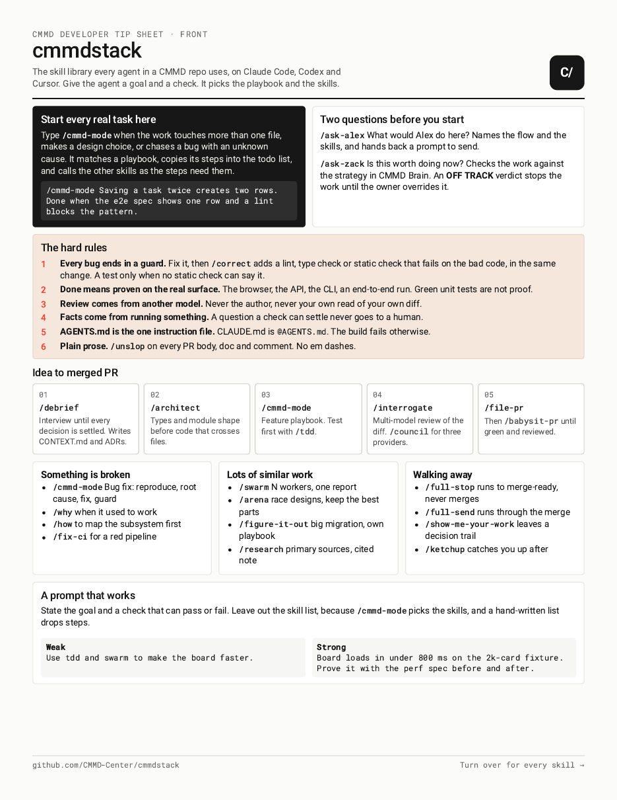
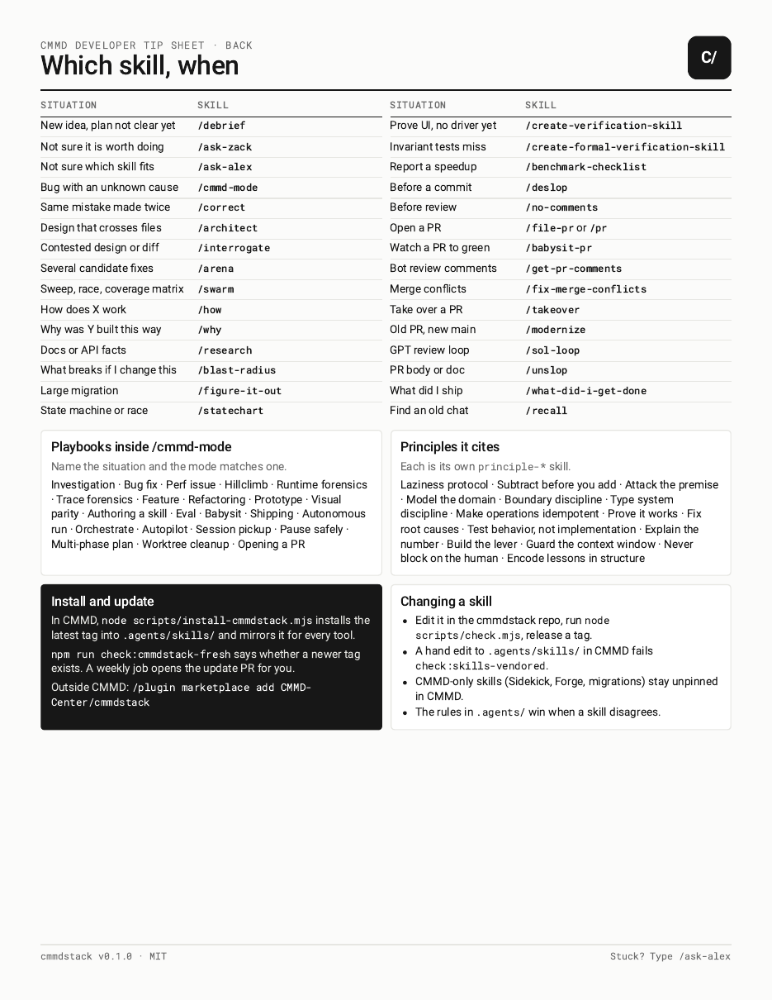

# cmmdstack

CMMD's skill library for AI coding agents. Give the agent a goal and a check; it picks the playbook and the skills. Works in Claude Code, Codex and Cursor.

<p>
  <a href="docs/tip-sheet.pdf"></a>
  <a href="docs/tip-sheet.pdf"></a>
</p>

The [tip sheet (PDF)](docs/tip-sheet.pdf) is the one-page guide. Print it double-sided.

## Install

**In a CMMD repo**, from the repo root:

```sh
node scripts/install-cmmdstack.mjs     # installs the latest release
```

**Anywhere else, in Claude Code:**

```
/plugin marketplace add CMMD-Center/cmmdstack
/plugin install cmmdstack@cmmdstack
```

**In Codex:** `codex plugin marketplace add CMMD-Center/cmmdstack`, then turn on `cmmdstack` in `/plugins`.

Pick one way per repo, or every skill shows up twice.

## Connect to CMMD

Run `/connect-cmmd` once per machine. You approve it in the browser, and your agents can then read your company's strategy, Brain and board. The login does not expire.

## Use it

| Type | When |
|---|---|
| `/cmmd-mode <goal and how you'll know it's done>` | Any real task: a feature, a bug, a refactor |
| `/ask-alex` | Not sure which skill or flow fits |
| `/ask-zack` | Not sure the work is worth doing |
| `/correct` | After every bug: adds the check that stops it coming back |
| `/ketchup` | Catch up on what happened while you were away |

A good prompt: *"Saving a task twice creates two rows. Done when the e2e spec shows one row and a lint blocks the pattern."* Leave the skill list out; `cmmd-mode` picks them.

## Hard rules

- Every bug ends with a lint or static check that catches it next time.
- Done means proven on the real thing: the browser, the API, the CLI.
- Review comes from a different model than the one that wrote the code.
- Plain prose, no em dashes.

<details>
<summary>All skills</summary>

| Area | Skills |
|---|---|
| Start here | `cmmd-mode`, `ask-alex`, `ask-zack`, `alex-mode`, `cmmd-help`, `setup-cmmdstack`, `connect-cmmd`, `cmmd-visual-style` |
| Planning and design | `debrief`, `architect`, `arena`, `interrogate`, `figure-it-out`, `statechart`, the `principle-*` skills |
| Investigation | `how`, `why`, `research`, `blast-radius`, `recall` |
| Fixing mistakes for good | `correct`, `deslop`, `no-comments`, `thermos`, `thermo-nuclear-review`, `thermo-nuclear-code-quality-review` |
| Verification | `create-verification-skill`, `maintain-verification-skill`, `create-formal-verification-skill`, `maintain-formal-verification-skill`, `benchmark-checklist`, `test-assertion-quality`, `tdd` |
| Parallel work | `swarm`, `parallel-agent-work`, `worktree-main-sync`, `durable-workflow-review` |
| PRs and shipping | `pr`, `pr-protocol`, `file-pr`, `babysit`, `babysit-pr`, `fix-ci`, `fix-merge-conflicts`, `get-pr-comments`, `leaving-pr-comments`, `make-pr-easy-to-review`, `full-send`, `full-stop`, `takeover`, `modernize`, `council`, `sol-loop` |
| Writing | `unslop`, `technical-writing`, `in-your-own-words`, `sharpen`, `teach` |
| Catching up | `ketchup`, `ketchup-video`, `what-did-i-get-done`, `show-me-your-work`, `reflect`, `bro` |
| Upkeep | `cleanup`, `automate-me`, `karpathy-guidelines`, `typescript-best-practices` |

</details>

## Changing a skill

1. Edit it under `skills/`.
2. Run `node scripts/check.mjs`. It has to pass.
3. Release with `node scripts/release.mjs X.Y.Z`, then `git push origin main vX.Y.Z`. CMMD's weekly job opens the update PR.

Keep skills free of any one repo's private details. Anything a skill draws uses CMMD's look from `cmmd-visual-style`. The tip sheet is built from `docs/tip-sheet.src.html` by `node scripts/build-tip-sheet.mjs`.

## License

MIT, built on boonstack, pstack, tstack and mattpocock/skills (all MIT). See [LICENSE](LICENSE) and [NOTICE](skills/cmmd-mode/references/licenses/NOTICE.md). The CMMD logo and app icons are CMMD's marks and are not covered. No telemetry: skills run locally and with your own model and GitHub logins.
